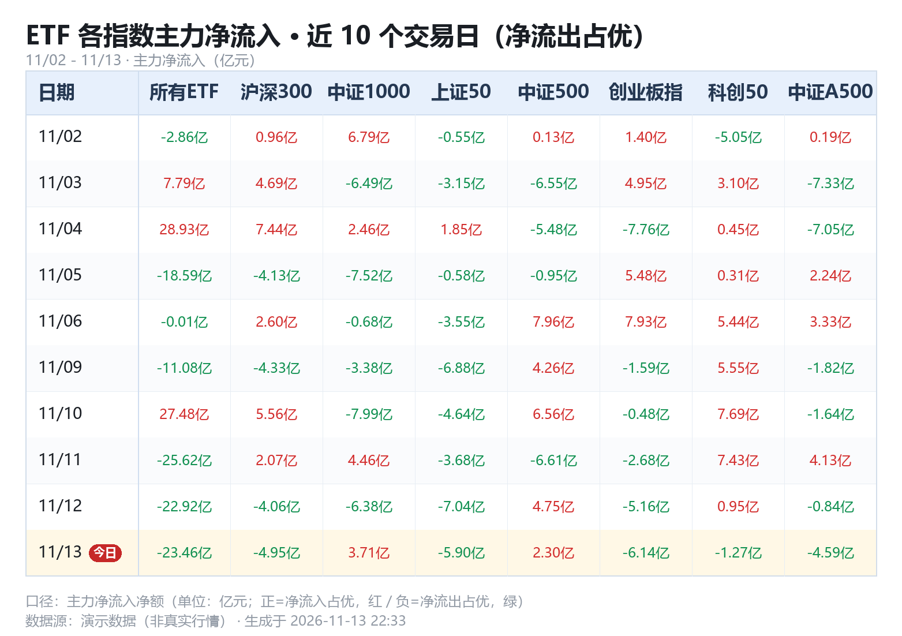

# ETF 资金流向 → 飞书每日推送

> 每交易日 20:03（北京时间）汇总全市场 ETF 主力资金净流入，按 8 个宽基指数出图并推送飞书。
> 无服务器、无数据库，历史数据存于仓库 `data/history.json`。



## 快速开始

1. Fork / Clone 仓库。
2. 飞书群添加自定义机器人，建议开启加签。
3. 配置 Secrets：

| Secret | 必填 | 用途 |
| --- | --- | --- |
| `FEISHU_WEBHOOK` | 是 | 群机器人 Webhook |
| `FEISHU_SECRET` | 否 | 加签密钥；开启加签时必填 |
| `FEISHU_APP_ID` / `FEISHU_APP_SECRET` | 否 | 自建应用凭证；发图片消息必需 |
| `ALERT_WEBHOOK` / `ALERT_SECRET` | 建议 | 独立告警机器人及加签密钥 |
| `EM_PROXY_URL` / `EM_PROXY_TOKEN` | 否 | 东财转发代理及其共享密钥 |

4. Actions → `daily-push.yml` → Run workflow 手动验证。

> 图片消息需要飞书自建应用开通 `im:resource`；未配置时自动降级为卡片消息，卡片失败再降级为文本卡片。

## 运行节奏

| 北京时间 | 任务 | 说明 |
| --- | --- | --- |
| 20:03（交易日） | 主档抓取 + 出图 + 推送 | `daily-push.yml` |
| 21:03 / 22:03 | cron 兜底档 | 按数据日期判重，不重复推送 |

## 本地开发

```bash
pip install -r requirements.txt
python push.py --demo          # 用演示数据看样式，不抓数、不推送
python push.py --dry-run       # 真实抓数，不推送
python -m unittest discover -s tests
```

## 目录结构

- `push.py` / `backfill.py`：主流程与历史补数
- `etfpush/`：配置、数据源、聚合、渲染、飞书推送
- `data/`：ETF 代码表与历史数据；`worker/`：可选东财转发代理

## 安全说明

- Webhook、加签密钥、App Secret、代理令牌只通过 Secrets 提供。
- 加签要么两个机器人都开，要么都不开；`19021` 表示加签校验失败。
- 代理 Worker 的 `PROXY_TOKEN` 与仓库 `EM_PROXY_TOKEN` 必须一致。

## 排错

- **只收到卡片没有图片**：检查 `FEISHU_APP_ID` / `FEISHU_APP_SECRET` 与 `im:resource` 权限。
- **19021**：补配 `FEISHU_SECRET` 或 `ALERT_SECRET`。
- **接口被限流**：配置 `EM_PROXY_URL` / `EM_PROXY_TOKEN` 走 Cloudflare 代理，失败会自动回退直连。

## 免责声明

本工具仅用于信息聚合与研究复盘，不构成投资建议。市场有风险，投资需谨慎。

## License

MIT

## 详细文档

- [统计口径、数据源与完整排错](docs/README-full.md)
